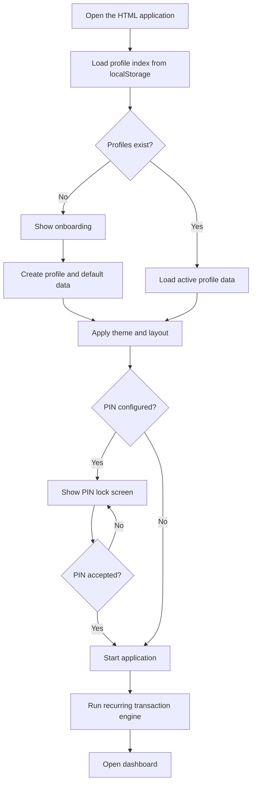
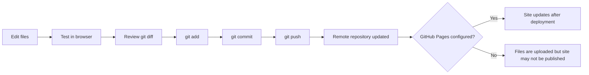

# Personal Expense Tracker

A single-page, offline-first expense and income tracker built with **HTML, CSS, and vanilla JavaScript**. The application keeps each profile's financial records in browser storage and includes tools for budgeting, recurring transactions, reports, currency conversion, and data backup.

> **Current project documentation:** This README describes the current implementation represented by the supplied project documentation. No numbered software release/version was provided, so this file does not assign one.

## Table of Things

- [Overview](#overview)
- [Features](#features)
- [Technology and project structure](#technology-and-project-structure)
- [Getting started](#getting-started)
- [How the application works](#how-the-application-works)
- [Data storage and privacy](#data-storage-and-privacy)
- [Backup, restore, and export](#backup-restore-and-export)
- [Browser compatibility](#browser-compatibility)
- [Development workflow](#development-workflow)
- [Known limitations](#known-limitations)

## Overview

Personal Expense Tracker helps users record income and expenses, organize transactions, set budgets, schedule recurring entries, and review financial activity. The application is implemented in a single HTML file: the page structure, styles, and JavaScript logic are embedded together.

The core tracking workflow does not require a server-side database or an online account. Records are stored in the browser on the current device. Currency conversion may need an internet connection when fresh exchange rates are requested.

## Features

- **Multiple local profiles** with separate financial datasets.
- **Income and expense tracking**, including categories, subcategories, payment methods, descriptions, merchants, and locations.
- **Transaction search, filtering, and sorting** by text, type, category, payment method, date range, and amount.
- **Dashboard** with balance, monthly income and expenses, remaining amount, today's spending, budget status, and recent transactions.
- **Calendar** for viewing transaction activity by date.
- **Reports and charts** for monthly/yearly summaries, savings, category distribution, daily spending, and payment-method breakdowns.
- **Monthly budgets**, including overall and category-specific limits.
- **Recurring transactions** on daily, weekly, monthly, or yearly schedules.
- **Themes and layout preferences**, including Light, Dark, and System themes.
- **Optional PIN lock** to discourage casual access on the same device.
- **Currency converter** with built-in currency definitions for INR, USD, EUR, GBP, JPY, CAD, AED, and AUD, plus custom currencies.
- **JSON backup and restore** for moving or recovering profile data.
- **CSV transaction export** for spreadsheet use.
- **Optional local-folder JSON copies** in supported browsers through the File System Access API.
- **Saved descriptions** for reusing common transaction descriptions.
- **Responsive layout** with mobile navigation at narrower screen widths.

## Technology and project structure

| Technology | Purpose |
|---|---|
| HTML | Application structure, forms, pages, dialogs, and navigation |
| CSS | Themes, responsive layout, cards, forms, and interface styling |
| Vanilla JavaScript | State, validation, calculations, navigation, recurring rules, and import/export |
| `localStorage` | Primary in-browser storage for profiles and financial data |
| IndexedDB / browser file APIs | May be used to retain a selected local-folder handle and write optional JSON copies, where supported |
| Git and GitHub | Source control and remote repository hosting; GitHub Pages can publish the static website when configured |

Suggested repository structure:

```text
personal-expense-tracker/
├── index.html    # Application: HTML, CSS, and JavaScript
└── README.md     # Project documentation
```

The application itself is designed as a single HTML file. The structure above is a suggested layout, not a requirement imposed by the application.

## Getting started

### Run locally

1. Download or clone the project repository.
2. Open the project folder in Visual Studio Code or another editor.
3. Open `index.html` in a supported browser. If a browser feature requires a secure context, use `localhost` or an HTTPS deployment where applicable.
4. On first launch, follow onboarding to create a profile, enter a name, optionally choose a picture, and select a currency.
5. Add income and expenses, then explore the dashboard, transactions, calendar, reports, budgets, and settings.

No package installation or build step is documented for the single-file application.

### Publish with GitHub Pages

1. Push the project files to a GitHub repository.
2. Open the repository's **Settings → Pages** section.
3. Choose the branch and folder containing the website files.
4. Wait for the Pages deployment to finish, then open the published URL.

GitHub Pages serves the static application files. It does **not** upload, back up, or synchronize visitors' browser-stored financial records.

## How the application works

### Startup flow



At a high level, initialization loads the profile index, loads the active profile's data, applies settings, checks the optional PIN lock, processes due recurring transactions, and opens the dashboard.

### Transaction lifecycle

1. Choose **Add Expense** or **Add Income**.
2. Enter the amount, date, category, and any optional details.
3. The application validates required fields and checks whether the entry resembles a recent duplicate.
4. The amount is converted to integer minor units before being stored.
5. The application creates a new record or updates the existing record when editing.
6. The active profile data is saved to browser storage and the relevant view is refreshed.

The amount must be numeric, positive, and within the application's allowed maximum. The date must be valid, a category is required, and future dates can be restricted in Settings.

### Profiles and data model

Each profile has a separate dataset. The shared profile index stores profile identifiers and display information; the active profile's data includes transactions, categories, payment methods, budgets, recurring rules, and settings.

Common data entities include:

- **Profile index:** profile ID, display name, optional avatar, and creation date.
- **Transaction:** ID, type, date/time, amount in minor units, category, subcategory, payment method, description, merchant, location, and timestamps.
- **Recurring rule:** transaction type, amount, frequency, interval, start/end dates, pause state, and generation tracking.
- **Settings:** currency, theme, layout, custom currencies, saved descriptions, PIN hash, and future-date preference.
- **Budgets and categories:** profile-specific budget values and transaction classification options.

Transaction amounts are stored as integer minor units to reduce floating-point rounding errors. For example, `₹12.50` is represented as `1250` in a currency with two decimal places.

### Recurring transactions

Recurring rules are checked when the application starts and when the active profile is switched. Due entries are generated up to the current date, and the application checks for an existing entry for the same rule and scheduled date to reduce duplicate generation.

Weekly schedules use seven-day intervals multiplied by the configured interval. Monthly and yearly schedules are calculated from the original start date to reduce date drift. The recurring engine runs when the application is opened; it is not a background service and does not run while the browser is closed.

## Data storage and privacy

The application uses browser `localStorage` as its primary in-app data store. The main key patterns are:

| Key | Purpose |
|---|---|
| `ledger:users` | JSON array containing the profile index |
| `ledger:activeUser` | ID of the active profile |
| `ledger:data:<profile-id>` | Full data for a profile |
| `ledger:data:<profile-id>:pre-restore:<timestamp>` | Safety copy created before restoring a backup |
| `ledger:data:<profile-id>:corrupt-backup:<timestamp>` | Retained raw data when malformed profile data is detected |
| `ledger:currencyRates` | Cached currency-rate data |

Important storage notes:

- Data is associated with the browser profile and website origin. It does not automatically move to another browser, device, or origin.
- Clearing browser/site data may permanently remove locally stored records. Export backups regularly and keep them somewhere safe.
- Browser storage has finite capacity. If storage is unavailable or full, saving may fail and the application may show a warning.
- The optional local-folder feature writes an additional JSON copy; `localStorage` remains the primary in-app source of data.
- The application does not require a remote application server for its core tracking workflow. Currency-rate requests, browser extensions, browser sync, and saved backups are outside the app's local-storage boundary.

### PIN security

The optional PIN is stored as a hash-like value rather than as the plain PIN. It is intended to discourage casual access on the same device, **not to encrypt financial data**. Someone with access to browser developer tools or local storage may be able to inspect or change stored data. Do not treat the PIN as a substitute for device security or encrypted storage.

## Backup, restore, and export

### JSON backup

The backup feature downloads a JSON bundle containing application metadata, a backup version, an export timestamp, and the active profile's data. The filename follows a pattern such as:

```text
ExpenseTracker_Backup_YYYY-MM-DD.json
```

### Restore

1. Select a JSON backup file.
2. The application checks that the file is valid JSON and contains a `transactions` array, directly or under a `data` property.
3. Confirm the restore operation.
4. The application creates a safety copy of the current profile data in browser storage.
5. The imported data replaces the active profile's data; settings are merged with defaults, then the application saves and refreshes the interface.

Restoring replaces the current active profile's data. Keep an additional backup before restoring important records.

### CSV export

CSV export produces a spreadsheet-friendly file of transactions. Use JSON backups for restoring application data; CSV exports are intended for viewing or analysis and are not a substitute for a full JSON backup.

### Optional local-folder storage

In supported browsers, Settings can connect a user-selected folder and write a separate JSON copy for each profile. The browser may ask for folder permission again. If folder access is unavailable, use JSON Backup & Restore instead. Deleting a profile attempts to remove its associated subfolder when permissions and browser support allow it.

## Browser compatibility

The core tracker uses standard browser technologies. Support for optional folder access depends on the browser and security context:

- Desktop Chromium-based browsers such as Chrome and Edge generally support the File System Access API on secure contexts, including HTTPS and `localhost`.
- Safari does not provide the same directory-picker API; use JSON Backup & Restore when folder access is unavailable.
- If a browser cannot provide a native JSON file picker, the application may use a standard file input for importing JSON where supported.

Browser-specific behavior should be tested in the target browser after changes. GitHub Pages hosts the website but cannot access or synchronize a visitor's local folder contents.

## Development workflow

A typical workflow using Visual Studio Code and Git is:



Example commands:

```bash
git status
git diff
git add index.html README.md
git commit -m "Update expense tracker documentation"
git push origin main
```

A local commit does not update the remote repository until it is pushed. A push does not guarantee that the site is published; GitHub Pages must be configured and deployment must complete.

## Known limitations

- The application stores financial data locally in the browser; records are not automatically synchronized across devices.
- Browser storage can be cleared, unavailable, or full.
- The optional PIN is not encryption.
- Recurring entries are generated when the app runs, not while it is closed.
- Currency conversion may require internet access for fresh rates and should not be treated as a guaranteed live source while offline.
- Folder access depends on browser support and permission grants.
- Restoring a JSON backup replaces the active profile's current data after confirmation.
- A successful JavaScript syntax check cannot guarantee that every interface interaction works; test the application in a browser after making changes.

## Current feature checklist

- [x] Multiple local profiles with separate financial datasets
- [x] Income and expense tracking
- [x] Categories, subcategories, payment methods, search, filters, and sorting
- [x] Dashboard, calendar, reports, and monthly/category budgets
- [x] Recurring income and expenses (daily, weekly, monthly, yearly)
- [x] JSON backup/restore and CSV transaction export
- [x] Optional profile-specific JSON copies in a user-selected local folder
- [x] Profile deletion flow with an optional backup download
- [x] Theme settings and optional PIN lock
- [x] Currency converter and custom currencies

---

**Project:** Personal Expense Tracker  
**Application type:** Single-page, offline-first web application  
**Primary technologies:** HTML, CSS, vanilla JavaScript, browser storage  
**Version:** Not specified in the supplied project documentation
