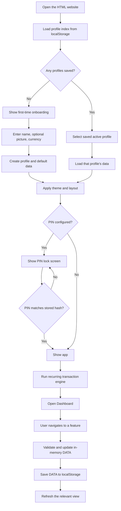
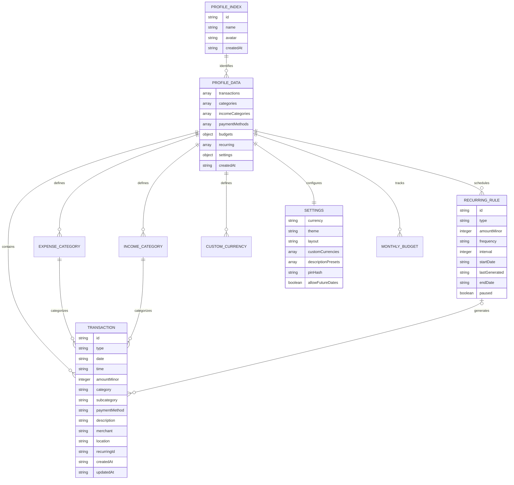
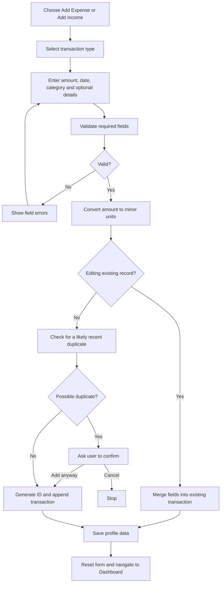
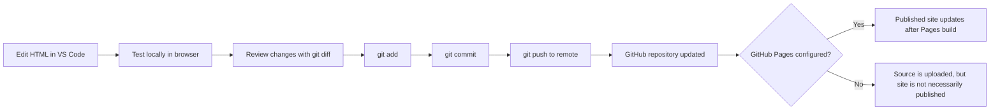

# Personal Expense Tracker — Workflow & Architecture

**Project name:** Personal Expense Tracker (Ledger)  
**Application type:** Single-page, offline-first web application  
**Main technologies:** HTML, CSS, vanilla JavaScript, browser `localStorage`  
**Development workflow:** Visual Studio Code → Git local repository → remote Git repository → GitHub Pages (if enabled)

---

## 1. Project overview

Personal Expense Tracker helps a user record income and expenses, organize transactions, set budgets, automate recurring entries, and review financial activity. It is implemented in one HTML file: the page structure, styling, and JavaScript application logic are embedded in the same file.

The app is designed to keep its financial records in the browser on the current device. It does not require a server-side database or an online account for its core tracking features. Currency conversion may use network access when a rate lookup is requested; the rest of the local tracking workflow is designed to work offline.

> **Privacy note:** Data stored in `localStorage` is tied to the browser origin and browser profile. Clearing site data, changing browsers, or using a different device does not automatically move the data. Use the backup feature to make a portable copy.

## 2. High-level application workflow



### Startup sequence

1. `init()` runs when the script loads.
2. `loadUsers()` reads the profile list and active-profile ID.
3. If no profiles exist, the onboarding screen is shown.
4. Otherwise, the active profile is validated and `loadDataForUser(id)` loads its data.
5. `startApp()` applies the theme, updates the profile display, and checks whether a PIN is configured.
6. If PIN protection is enabled, the lock screen is displayed until the PIN is accepted.
7. The recurring engine generates any due recurring transactions that are missing.
8. `navigate('dashboard')` opens the dashboard and renders its values.

---

## 3. Main entities and relationships

The following diagram describes the main data entities in the application. These are JavaScript objects and arrays stored as JSON, not database tables.



### Entity explanations

| Entity | Purpose |
|---|---|
| **Profile index (`USERS`)** | Holds each profile's ID, display name, optional avatar, and creation date. |
| **Profile data (`DATA`)** | The full independent dataset for the currently active profile. |
| **Transaction** | One income or expense record, including amount, date/time, category, payment method, description, merchant, and location. |
| **Expense categories** | Categories such as Food, Transport, Home, Shopping, Health, Education, Entertainment, Technology, and Other. Categories can include subcategories. |
| **Income categories** | Categories such as Salary, Freelance, Business, Interest, Gifts, and Other. |
| **Recurring rule** | Describes a transaction to generate daily, weekly, monthly, or yearly, with interval, start/end dates, and pause state. |
| **Budget** | Monthly overall and category budget values, stored under the `budgets` object. |
| **Settings** | Per-profile currency, theme, layout density, future-date preference, custom currencies, saved descriptions, PIN hash, and backup timestamp. |
| **Custom currency** | A user-defined currency code, name, and symbol, added to the built-in currency list. |
| **Saved description** | A reusable transaction description managed in Settings and shown as a shortcut on the transaction form. |

### Important implementation details

- The profile index is shared by the app, while each profile's full data is stored separately.
- Transaction amounts are stored as integer minor units (`amountMinor`) to reduce floating-point rounding errors. For two-decimal currencies, `₹12.50` is stored as `1250`.
- Transactions use generated IDs such as `EXP-YYYYMMDD-001` or `INC-YYYYMMDD-001`.
- A transaction can optionally reference a recurring rule through `recurringId`.
- Profile settings and categories are copied from defaults when a new profile is created. Loading older data merges it with defaults to help maintain compatibility.

---

## 4. Browser storage design

The application uses these main `localStorage` keys:

| Key pattern | Contents |
|---|---|
| `ledger:users` | JSON array of profile-index entries. |
| `ledger:activeUser` | ID of the active profile. |
| `ledger:data:<profile-id>` | Full JSON data for one profile. |
| `ledger:data:<profile-id>:pre-restore:<timestamp>` | Safety copy made before restoring a backup. |
| `ledger:data:<profile-id>:corrupt-backup:<timestamp>` | Raw saved data retained when the loader detects malformed profile data. |
| `ledger:currencyRates` | Currency-rate cache key used by the currency-converter feature. |

Core storage functions:

- `loadUsers()` — reads the profile list and active profile.
- `saveUsers()` — persists the profile list.
- `setActiveUser(id)` — records the active profile ID.
- `dataKey(id)` — constructs the key for a profile's data.
- `defaultData(currency)` — creates a fresh profile data structure.
- `loadDataForUser(id)` — loads, validates, and migrates profile data.
- `saveData()` — writes the current `DATA` object to the active profile's key.

`localStorage` is synchronous browser storage. If the browser's quota is exceeded or storage is unavailable, the application may be unable to save; the app shows a warning toast when `saveData()` catches a storage error.

---

## 5. Transaction workflow



### Required validation

- Amount must be present, numeric, greater than zero, and within the application's allowed maximum.
- Date must be a valid calendar date.
- Future dates can be restricted using Settings.
- A category must be selected.

### Add versus edit

- **Add:** creates a new transaction ID and sets `createdAt`.
- **Edit:** finds the transaction by `EDIT_ID`, merges the submitted fields into that same record, and sets `updatedAt`. It does not intentionally create a second record.
- A possible duplicate is detected when a very similar transaction was created within the last five minutes; the user can choose whether to add it anyway.
- After a successful change, the application calls `saveData()` and refreshes the interface.

### Transaction display and filtering

The Transactions page filters by search text, type, category, payment method, date range, and minimum/maximum amount. Sorting options include newest, oldest, highest amount, lowest amount, and category. The search includes descriptions, category/subcategory, merchant, location, payment method, tags when present, amount, and date.

---

## 6. Feature workflows

### Dashboard

The dashboard derives its figures from the active profile's transactions and budgets. It displays balance, monthly income, monthly expenses, remaining amount, today's spending, current-month spending, budget status, quick-add options, and recent transactions.

The dashboard is a view of the saved transaction data; its summary figures are calculated from the underlying records rather than stored as a separate ledger.

### Calendar

The calendar groups transaction activity by date. Selecting a day opens the relevant daily details. Calendar navigation changes the displayed month and refreshes the calendar view.

### Reports

The Reports section calculates monthly and yearly summaries from transactions. It includes income, expenses, savings, top category, largest expense, category distribution, daily spending, payment-method breakdown, and other statistics. Charts are rendered in the page using canvas/SVG-based UI code.

### Budgets

Budgets are stored per profile and organized by month. The app supports an overall monthly budget and category budgets. Budget progress is calculated by comparing expenses in the selected month with the configured limits.

### Recurring transactions

1. A recurring rule is saved with its type, amount, category, frequency, interval, start date, and optional end date.
2. When the app starts and when the active profile is switched, `runRecurringEngine()` checks unpaused rules.
3. It calculates due dates and creates missing transactions up to today.
4. Each generated transaction receives the rule's `recurringId` and a `recurring` tag.
5. Existing generated transactions are checked before insertion to avoid generating the same rule/date combination twice.
6. Newly generated entries are saved to the profile.

The engine has a loop guard to avoid an unbounded generation loop. Recurring entries are generated when the app runs; this is not a background server or scheduled task running while the browser is closed.

### Profiles

- Each profile has its own data key and financial records.
- Creating a profile creates a new default dataset and makes that profile active.
- Switching profiles loads the selected profile's data, applies its theme, runs the recurring engine, and opens the dashboard.
- Deleting a profile removes its local data after confirmation. Deleting the active profile switches to another profile when available; if none remain, onboarding is shown.

### Settings

Settings include profile management, theme (Light/Dark/System), layout density, currency, future-date preference, saved descriptions, custom currencies, and PIN controls. Theme and layout are applied to the page using CSS variables and classes.

Saved descriptions are profile-specific shortcuts. They fill the transaction Description field; they are not a separate transaction or category.

### Currency converter

The app includes built-in currency definitions for INR, USD, EUR, GBP, JPY, CAD, AED, and AUD, plus profile-specific custom currencies. The converter can use cached rate data and may require network access to obtain fresh rates. It should not be treated as a guaranteed live rate source while offline.

### Backup and restore

**Backup**
1. The app records the backup timestamp.
2. It creates a JSON bundle containing the app name, backup version, export timestamp, and active profile's `DATA`.
3. The browser downloads a file named like `ExpenseTracker_Backup_YYYY-MM-DD.json`.

**Restore**
1. The user selects a JSON file.
2. The app checks that it is valid JSON and contains a `transactions` array, either directly or under `data`.
3. The app asks for confirmation.
4. It writes a safety copy of the current profile data to a separate local-storage key.
5. It replaces the active profile's data with the imported data, merges settings with defaults, saves, and refreshes the dashboard.

**CSV export** creates a spreadsheet-friendly export of transactions. Keep JSON backups in a safe place because local browser data is not automatically synchronized.

---

## 7. PIN and privacy workflow

- The PIN is stored as a hash-like value in the active profile's settings, not as the plain PIN.
- On startup, if `pinHash` exists, the app hides the main app shell and shows the lock screen.
- When a PIN is entered, the app hashes it and compares the result with the stored value.
- A matching value unlocks the app; a mismatch displays an error.

**Security limitation:** The PIN is intended to discourage casual access on the same device. It is not encryption for the underlying financial data. A person with access to browser developer tools or the browser's local storage may be able to inspect or change stored data. Do not treat the PIN as a substitute for device security or encrypted storage.

The HTML application does not require a remote application server for its core workflow. However, browser extensions, browser sync, backups, and the currency converter's network requests are outside the app's local-storage boundary.

---

## 8. Interface and responsive design

- **HTML:** defines the onboarding, lock screen, app shell, navigation, pages, forms, modal root, and toast root.
- **CSS:** defines theme variables, light/dark appearance, layout, cards, forms, responsive navigation, modal styling, and login/onboarding animations.
- **JavaScript:** owns application state, validation, storage, navigation, calculations, profile switching, recurring rules, reports, and export/restore actions.
- **Single-page navigation:** `navigate(route)` hides the other page sections, displays the requested section, and calls the relevant render function.
- **Modal system:** `openModal()` creates dialogs in `#modalRoot`; `closeModal()` clears the modal. Toast messages are rendered in `#toastRoot`.
- **Mobile layout:** the sidebar is replaced by a top bar and bottom navigation at narrower screen widths.

The finance-themed welcome and login animations are decorative. They do not represent actual account balances or transactions.

---

## 9. Development and publishing workflow



Typical commands:

```bash
git status
git diff
git add index.html README.md
git commit -m "Improve expense tracker workflow documentation"
git push origin main
```

For GitHub Pages, the published branch/folder must be configured in repository settings. If the website is published from the `main` branch and root folder, changes pushed to that branch normally publish after the Pages deployment completes. A local commit alone does not update the remote repository, and a push does not guarantee publication if Pages is not configured correctly.

### Suggested project structure

```text
personal-expense-tracker/
├── index.html    # Entire application (HTML, CSS and JavaScript)
└── README.md     # Project documentation and workflow
```

This is a suggested structure. The app itself is implemented as a single HTML file; the documentation is separate.

---

## 10. Important limitations and maintenance notes

- The app stores data in browser `localStorage`, which has finite capacity and can be cleared by the user or browser.
- Profiles are separate local data sets, not online user accounts.
- The PIN lock is not strong encryption.
- The recurring engine runs when the app starts or a profile is switched; it does not run in the background while the app is closed.
- The currency converter may need an internet connection to retrieve exchange rates.
- Restoring a backup replaces the current active profile's data after confirmation. Keep an additional backup before important changes.
- GitHub Pages hosts the website files; it does not automatically store or synchronize each visitor's `localStorage` records.
- Test changes in a browser after editing. A JavaScript syntax check catches syntax errors but cannot guarantee every UI interaction works correctly.

---

## 11. Quick reference: important functions

| Function | Responsibility |
|---|---|
| `init()` | Starts the app's initialization workflow. |
| `loadUsers()` / `saveUsers()` | Read and write the profile index. |
| `defaultData()` | Creates the initial profile data structure. |
| `loadDataForUser()` / `saveData()` | Load, migrate, and persist the active profile's data. |
| `applyTheme()` | Applies the selected theme and layout density. |
| `navigate(route)` | Switches between app pages and renders the selected page. |
| `runRecurringEngine()` | Generates due recurring transactions that do not already exist. |
| `renderDashboard()` | Calculates and displays dashboard summaries. |
| `renderTransactionsPage()` | Renders transaction search, filters, sorting, and the ledger. |
| `renderCalendar()` | Renders the calendar view. |
| `renderReports()` | Calculates and renders report summaries and charts. |
| `renderBudgets()` | Displays budget limits and spending progress. |
| `renderBackupPage()` | Displays backup status and data summary. |
| `backupBundle()` | Builds the JSON backup payload. |
| `attemptUnlock()` | Verifies the entered PIN against the stored hash value. |
| `startApp()` | Applies settings, checks the lock, runs recurring rules, and opens the dashboard. |

---

## 12. End-to-end summary

The user creates or selects a local profile. The application loads that profile's data from `localStorage`, checks the PIN setting, applies appearance preferences, and opens the dashboard. Every add/edit/delete or settings action updates the in-memory profile data and saves it back to the profile's storage key. Dashboard, calendar, transactions, budgets, and reports read from this shared data. Recurring rules add due transactions when the app starts. Backup and CSV export let the user move or analyze records outside the browser, while restore imports a previous JSON snapshot.

The main data path is:

**User action → JavaScript validation/business logic → update `DATA` → `saveData()` → `localStorage` → re-render the relevant view.**
